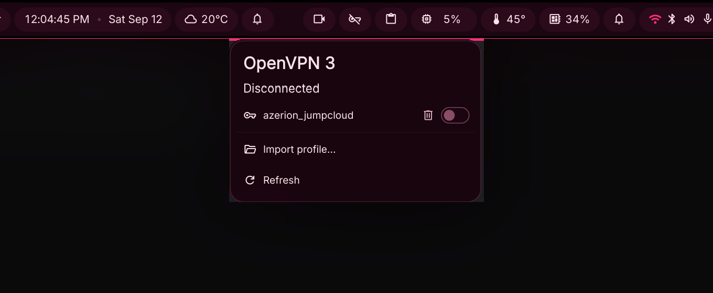

# OpenVPN 3

A [DankMaterialShell](https://github.com/AvengeMedia/DankMaterialShell) bar widget for the [openvpn3-linux](https://github.com/OpenVPN/openvpn3-linux) client. It shows the session status in the bar and connects, disconnects and imports profiles through the `openvpn3` command line tool.

<p align="center">
  
</p>

## Features

- Bar pill with the session state: connected (`vpn_lock`, accent colour), connecting (pulsing), waiting for a web login (warning colour), failed (error colour) or disconnected
- Optional profile name next to the icon while connected
- Popout with the current status and every imported profile: an on/off toggle per profile (switching to another profile disconnects the current one first), a delete button with confirmation, an **Import profile…** button and **Refresh**
- Web authentication: openvpn3 opens the login page in your browser; the popout keeps an **Open login page** row until the session is up, and the widget opens the URL itself only when openvpn3 reports it could not
- Right-click on the pill toggles the connection: disconnect, or connect the default (or most recently used) profile
- IPC for keybinds and scripts: `status`, `toggle`, `connect`, `disconnect`, `popout`, `importFile`, `refresh`
- Works with any compositor and bar orientation; vertical bars show the icon only
- Configurable from the DMS settings UI: profile name, refresh interval, login page fallback, persistent import, default profile
- Translatable; ships with Dutch

## Requirements

- DankMaterialShell >= 1.6.0
- [openvpn3-linux](https://openvpn.net/cloud-docs/owner/connectors/connector-user-guides/openvpn-3-client-for-linux.html) (`openvpn3` on `PATH`, the D-Bus services start on demand). Tested with v27.1
- `xdg-open` for web authentication

Profiles that ask for a username and password on the terminal are not handled by the widget. Start those from a terminal with `openvpn3 session-start -c <profile>`; the widget shows the session as soon as it exists. Profiles with certificates only or with web authentication (OpenVPN Cloud, SAML/JumpCloud, ...) work from the popout.

## Install

### From the plugin registry

DMS Settings (`Mod + ,`) → **Plugins** → **Browse** → *OpenVPN 3*, or:

```sh
dms plugins install openvpn3
```

Update later with `dms plugins update openvpn3`; remove with `dms plugins uninstall openvpn3`.

### Manual

```sh
git clone https://github.com/AleBles/dms-widget-openvpn3 \
  ~/.config/DankMaterialShell/plugins/openvpn3
dms restart
```

Then enable it in **DMS Settings → Plugins → OpenVPN 3** (or `dms ipc call plugins enable openvpn3`) and add the *OpenVPN 3* widget to a bar section under **DMS Settings → Bar → Widgets**.

## Usage

| Pill | Meaning |
|---|---|
| `vpn_key_off`, muted | No session (or `openvpn3` not installed: dimmed) |
| `vpn_key`, pulsing | Connecting, or disconnecting |
| `vpn_key_alert`, warning colour, pulsing | The server asked for a web login; the page is open in your browser |
| `vpn_lock`, accent colour, profile name | Connected |
| `vpn_key_off`, error colour | The session failed. The popout shows the openvpn3 status; click the profile to clean the session up |

Left-click opens the popout, right-click toggles the connection. While the popout is open, or a session is connecting, the status is refreshed every second; otherwise every *Status refresh* seconds (default 5).

## Importing profiles

**Import profile…** in the popout opens the DMS file browser (`*.ovpn`, `*.conf`). The file is imported under its base name, so `~/vpn/office.ovpn` becomes the profile `office`, persistent by default (`openvpn3 config-import --persistent`). The bin icon on a disconnected profile removes it after a confirmation (`openvpn3 config-remove`). The same from a terminal:

```sh
openvpn3 config-import -c ~/vpn/office.ovpn -n office -p
openvpn3 configs-list
openvpn3 config-remove -c office      # remove a profile
```

## IPC

```sh
dms ipc call openvpn3 status              # "connected office", "disconnected", "auth office", ...
dms ipc call openvpn3 toggle              # disconnect, or connect the default profile
dms ipc call openvpn3 connect "office"    # profile name from `openvpn3 configs-list`
dms ipc call openvpn3 disconnect
dms ipc call openvpn3 popout              # open or close the popout
dms ipc call openvpn3 importFile ""       # open the file browser; pass a .ovpn path to import it directly
dms ipc call openvpn3 refresh
```

Hyprland (`hyprland.conf`):

```ini
bind = SUPER SHIFT, V, exec, dms ipc call openvpn3 toggle
```

Hyprland (Lua config):

```lua
hl.bind("SUPER + SHIFT + V", hl.dsp.exec_cmd("dms ipc call openvpn3 toggle"))
```

niri (`config.kdl`):

```kdl
Mod+Shift+V { spawn "dms" "ipc" "call" "openvpn3" "toggle"; }
```

## Settings

| Setting | Default | Notes |
|---|---|---|
| Show profile name | on | Name of the connected profile next to the icon (horizontal bars) |
| Name width | 120 px | Longer names are cut with an ellipsis |
| Status refresh | 5 s | Poll interval while idle or connected; 1 s while connecting or with the popout open |
| Open login page as fallback | on | openvpn3 opens the login page itself; when it reports it could not, the widget runs `xdg-open` on the URL it prints |
| Persistent import | on | Imported profiles survive a reboot |
| Default profile | most recently used | Profile used by right-click and `toggle` when nothing is connected |

## Desktop notifications

openvpn3-linux ships a user service that turns session changes into desktop notifications, including the login URL. It combines well with the widget:

```sh
systemctl --user enable --now openvpn3-desktop-session-watcher.service
```

## Translations

The plugin ships Dutch (`translations/nl.json`); the English strings in the QML files are the source. DMS picks the file matching the shell locale automatically.

To add a language, create `translations/<locale>.json` (`de.json`, `zh_CN.json`, ...) with one bucket per English term:

```json
{
  "Disconnected": { "Disconnected": "Getrennt" }
}
```

Untranslated terms fall back to English. Reload with `dms ipc call plugins reload openvpn3` and switch the language under **DMS Settings → Locale** to check. Pull requests with new languages are welcome.

## Registry entry

`registry/alebles-dms-widget-openvpn3.json` is the entry for the [DMS plugin registry](https://github.com/AvengeMedia/dms-plugin-registry); it is generated from `plugin.json` with `bun scripts/registry.ts` (`--check` verifies it is current).

## License

[MIT](LICENSE)
